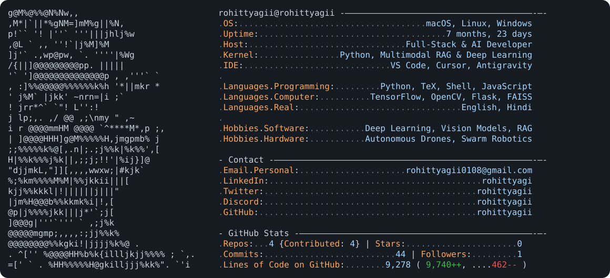

<picture>
  <source media="(prefers-color-scheme: dark)" srcset="dark_mode.svg">
  <source media="(prefers-color-scheme: light)" srcset="light_mode.svg">
  
</picture>

## 🛠️ Tech Arsenal

### 🧠 Deep Learning & Computer Vision

### 🤖 Generative AI & RAG

### 🌐 Backend & Web

### 🔬 Research & Autonomous Systems

### ⚙️ DevOps, Platforms & Tools

## 🌊 Contribution Activity

  

  

 

*Crafted with precision by Rohit Tyagi*

